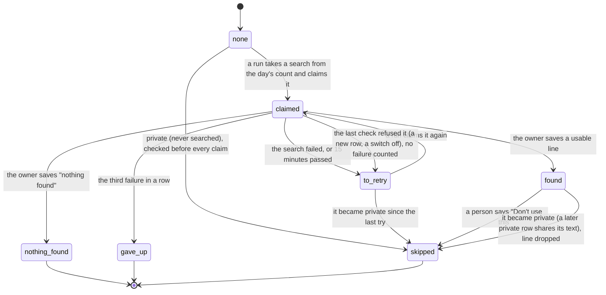
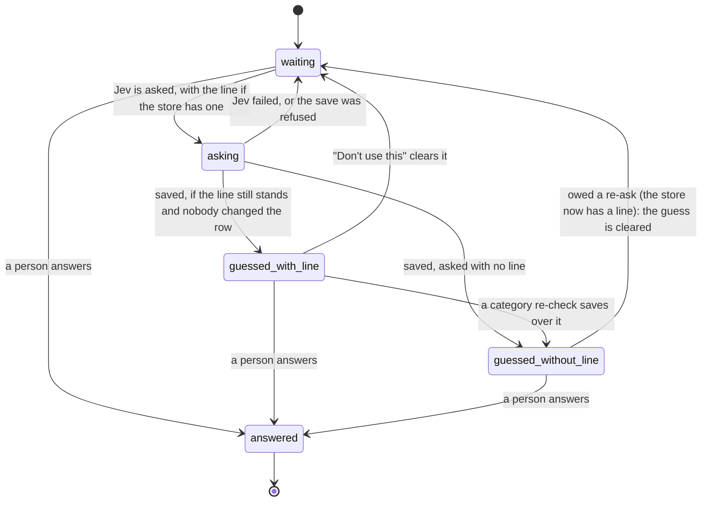

# Store lookup: a web search behind each new store

Status: approved by the owner in chat on 2026-11-12, with the three choices below settled as proposed. In the spec as §7 "Store lookup" and decision 216.

## What it is, in one sentence

The first time Tally sees a store's bank text, it searches the web for it once, keeps one short line about what the store is ("Coffee shop in Arlington, VA"), and tells Jev and the name run that line.

## Why

"LA COOP ARLINGTON Arlington VA" was guessed as "Maybe Groceries" at 61%. It is a coffee shop. The bank text was enough for a web search to say so, and nothing Tally sends its models today could. The owner's words: the search "would add even more to the name generation, the category suggestion would be much more accurate".

## Goals

- Jev's category answer and Workers AI's name suggestions get one more fact: what the store is.
- A person sees that fact on the card, so the guess explains itself.
- Each store is searched once, ever.

## Non-goals

- No agent, no chat, no LangChain or LangGraph. The bank text is already the right query, so nothing needs to decide what to search (owner agreed 2026-11-12).
- No model that decides whether a search is worth it. A search costs about half a cent and happens once a store; rules in code decide (owner agreed 2026-11-12).
- Nothing runs while a page loads. The lookup runs where Jev and the name run already do.
- Receipts (`src/ai/read-receipt.ts`) are untouched.

## Anti-goals (a failure even if it works)

- A person's name, an amount, a date or an account name reaching the search company.
- The lookup line being treated as an instruction by Jev or Workers AI.
- A search failure holding up sorting. A store with no lookup sorts exactly as it does today.
- The lookup deciding anything. It is context for a suggestion; people still decide.

## Approaches considered

1. **Look each store up once, keep the answer (picked).** A search by plain fetch, Workers AI condenses the results to one line, the line is stored against the merchant and passed to the existing runs. Fits the two-provider rule for models, adds one small module and one table.
2. **A model with search built in.** One call searches and answers. Less code, but it adds a third model provider beside Jev and Workers AI, which CLAUDE.md keeps to two.
3. **An agent that decides when and what to search** (the first idea, with LangGraph). It would be the first AI to run on a page load, adds a large dependency, and the choice it would make is already made by the bank text.

The owner picked 1 in chat on 2026-11-12.

## How it works

### The steps

1. A merchant row exists with no lookup (new from a sync, or from before this shipped).
2. The lookup run asks the code rules below whether this store may be searched.
3. If yes: one `fetch` to the search service with the redacted bank text as the query.
4. Workers AI reads the top results and answers with one line of at most 80 characters saying what kind of place it is and where, or "nothing found".
5. The line (or "nothing found") is stored against the merchant. It is never searched again.
6. When Jev is asked about a transaction of that merchant, the line is one more field of `JevInput`. When Workers AI is asked for a merchant's names (`suggestNames`, only for stores Plaid did not name, at night after sorting), the line is given too. The new-category name (`suggestCategoryName`) and the note line are not changed, and names already asked are not asked again.

### When it runs

In the same places sorting runs (spec §7): the night's Workflow and right after a sync, as a step **after** the sorting groups and before the name run. Never in a request a person is waiting on.

**After Jev's first answer, not before** (the owner's pick on 2026-11-12; the first design had it before). A store is searched only once Jev itself has answered at least one of its rows and none is still waiting for Jev or was given up on by Jev without an answer (such a row has no privacy answer, so it holds the store back until it is asked again and answered), so a row Jev flags as a transfer, income or a reimbursement is known before anything is sent. Jev's answer counts only when its privacy answers were kept: the row has Jev's category answer (with its transfer and reimbursement answers) and its income answer stored. With "Guess categories" or "Spot paychecks" off Tally keeps neither, even though Jev may still be asked for details, so nothing is searched while either switch is off, and the lookup switch is greyed as "Sort right away" is. A category a person chose, or a rule applied, is not that answer: filing "JANE DOE" under Kids does not say the payee is a store, so a store whose rows only a person or a rule has filed is not searched. A bare name such as "JANE DOE" under an ordinary Plaid category names no app or rail, and only Jev's answer can say it is a payment to a person. The cost: a new store's first guess is made without the line. The line reaches that store's later rows on their first ask, and its guesses that are still open are asked again; a row Jev filed confidently but wrongly on its first ask is not helped.

Stores that already exist when this ships are looked up by the same run, oldest first, under the daily cap, so the backlog drains over a few nights.

**Rows already guessed (the owner picked re-asking, 2026-11-12):** a line only helps a row asked after the line exists. Without more, the Maybes waiting today (la coop among them) and any first-import store sorted before its lookup landed would keep their old guess. When a store's lookup lands as `found`, Jev is asked again about that store's rows that are still uncategorized or an unanswered Maybe, within Jev's daily cap, as decision 157 does after a new category. Rows a person answered, and rows a rule filed, are never re-asked.

### When a store is not searched (code rules, no model)

This section says the same as spec §7 "Store lookup"; the spec wins if the two ever differ. The privacy table in "The model" below has one row for each case.

A store is searched only when **all** of these hold. The first three are about privacy, not cost: a person's name must never leave the app, and `redactBankTextForAi` drops numbers, not names.

1. **Something says it is a store (it fails closed).** At least one of its transactions carries a Plaid category that is not one of the private ones. A text none of whose rows Plaid gave a category is not searched; it becomes eligible if a later row arrives with one.
2. **Nothing says it is private.** It is stored as `skipped` and never searched when any of these holds, for any merchant and any transaction that shares its lookup text (one private row makes the text private):
   - a Plaid transfer category (`TRANSFER_CATEGORIES` in `src/db/plaid-transfers.ts`), Plaid's income category, or Plaid's bank-fees category (`BANK_FEES`: not a store; the owner's pick after a read of production found 12 of its 30 candidate texts were bank fees), or a row with a stored transfer, income or reimbursement flag, whoever set it (Plaid, Jev or a person), or an unanswered "Maybe transfer" or "Maybe income";
   - a payment app's name **anywhere** in the text as whole words (Venmo, Zelle, Cash App, PayPal, Apple Cash, Privacy.com's "PwP" virtual cards and the like, a short list in code: services people pay through, whose text names the service or a person, not the store);
   - a bank-rail phrase anywhere in the text (ACH, wire, a check, "payment to", "transfer to" and the like);
   - text that reads as an instruction;
   - nothing left after redaction, or once its words with a digit are dropped (an empty text is never sent and never used as a key).

   Every one of these text checks reads the text folded to plain characters (NFKC, so full-width "ＶＥＮＭＯ" is Venmo). These text checks run on the merchant key as stored **and on the raw bank text of every one of its transactions**, before cleaning and before the 40-character cut, since the cleaner strips "PAYPAL *" and a Plaid name can hide a raw text that names a rail.
3. **Cash, hand-entered and Apple Card rows never count as the sign in rule 1.** The name run already leaves these out (`src/db/merchant-names.ts`), and the lookup follows it. A text that only lacks the sign is not stored as `skipped`; it has no lookup yet and is looked at again when a new row arrives.
4. **No rule already settles it.** A merchant rule or bank-text rule on all of it leaves it not looked up; it is searched later only if the rule goes. A rule only stops the search: a line found before the rule was made is kept and still shown.
5. **It has not been looked up**, and the day's cap has room.

Privacy is checked again every time a run is about to claim a store, including one waiting to be tried again, so a store that became private since its last try is skipped, not searched. The whole test, the privacy rules, Jev's answers and the three switches ("Look up new stores on the web", "Guess categories" and "Spot paychecks"), is made once more immediately before each search is sent, so a row that arrived after the claim stops the search whether it is private or only still waiting for Jev, and a switch turned off after the claim stops it too; the claim is let go.

Stores Plaid already names are searched too when they pass these rules (the owner's pick, 2026-11-12). Workers AI is only asked for names when Plaid sends none (decision 68), so for a Plaid-named store the line helps Jev's category only, not the name.

### The states (the rule, stated once)

This follows the app's rule styles (decision 206). The owner noted these rules read like XState and Effect logic; here is where each fits.

- **Style 1, XState alone:** a new machine `src/machines/store-lookup.ts`, the one place the rule is stated, like `jev-retry.ts` and `merchant-suggestion.ts`. The SQL writers keep the column in step and a test walks every writer against the machine.

The store's lookup (the stored `status`; `claimed` and `to retry` are both stored as `pending`):



A row's guess, as the lookup sees it (the last two differ by its `lookup_answers` entry):



- **Not style 2 (the bridge):** the search is outside work, but the job is long and already has a home. Decision 209 point 3 sends a long wait on an outside service to the existing Workflow, so the search is a Workflow step and the machine only states the moves.
- **Not style 3 (Effect) for the run:** decision 206 keeps Effect style for write handlers; the lookup run is background work like sync and stays plain TypeScript.
- **Style 3 for the one write a person makes:** "Don't use this" on a lookup line is a write handler, so it is a `rule({...})` from `src/rules/terms.ts`, with its stories test beside it (decisions 211 and 212 retired `docs/write-handlers.json`, so there is no list to add it to).
- **`Schema` at the edge:** the search service's JSON is decoded with Effect `Schema` once, in the lookup module (decision 206).

### What leaves the app

- **To the search service:** the store's **lookup text**: the merchant key (`merchants.raw_name`: Plaid's `merchant_name` when the transaction has one, otherwise the bank's raw text, spec §6.1) after `cleanBankText` and `redactBankTextForAi` (decision 164: numbers, amounts and phone numbers dropped, 40 characters), and nothing else. No amount, date, account, household or user identifier. An instruction-like text is never sent (`bankTextToSend`'s check).
- **To Workers AI (already a provider):** the same redacted text and the search results' titles and snippets.
- **To Jev:** one new optional `JevInput` field, `storeLookup`, holding the stored line.

Search results are text from the open web, so the stored line is treated as untrusted: it is capped at 80 characters, stripped to letters, numbers and basic punctuation, dropped if it reads as an instruction (the existing check), and given to Jev and Workers AI as a labelled fact, never as part of their instructions.

### The search service

**Tavily** (the owner's pick, 2026-11-12; Brave was my first proposal). One `POST https://api.tavily.com/search` with a JSON body, so the query never sits in a URL, and the key in an `Authorization: Bearer` header. Reported at 1,000 free credits a month and about $0.008 a basic search after that. The price, the request fields and the rate limit (reported as 20 requests a minute) are from secondary sources; the builder confirms them on Tavily's own API reference before building (CLAUDE.md: never from memory).

**Tavily's terms, read on 2026-11-12** (privacy policy last updated 2025-11-24): it collects query data, may use parts of it to improve its answers, may share a query with other search index providers when its own index can't answer, and states no retention period. Its account setting "Allow Use of Query Data", when off, means query data "will not be stored or used for improvements". The owner turns that setting off before the production key is set (decision 216). Only redacted store text is sent and private payments are skipped either way.

All search calls go through one module, `src/ai/lookup-store.ts`, with one function signature, as Jev does through `categorize.ts`. Changing services changes only that file. The Workers AI call that writes the one line lives there too, so CLAUDE.md's "Workers AI only via" list gains this file.

### Storage

A new table (one migration), kept apart from `merchants` as `merchant_name_failures` is:

`merchant_lookups`: `lookup_text` (primary key: the redacted text that is sent, see "What leaves the app"), `status` (`found`, `nothing_found`, `skipped`, `gave_up`, or `pending` for a store a run has claimed or is to try again), `line` (null unless `found`), `attempts`, `claimed_at`, `claimed_by`, `failed_at`, `looked_up_at`. No row means `none`.

`lookup_answers`: `transaction_id` (primary key), `lookup_text`. One row for each transaction whose stored Jev answer was asked with the line.

Four rules the review of the plan added (PR #997):
- **Claim before calling.** A run claims a store in the table before it searches, and searches only what it claimed, so two runs at once make one search.
- **Count every search.** The day's cap is a counter of its own, taken before the calls as Jev's is, not worked out from the rows' last timestamps.
- **Privacy is checked on the merchant key as stored**, before cleaning and the 40-character cap (the cleaner strips "PAYPAL *"), and when several merchants share one lookup text, one private merchant makes the text private.
- **It fails closed.** A text is searched only when at least one of its transactions carries a Plaid category outside the private ones; a text with no Plaid category at all is not searched, and a bank-rail phrase (ACH, wire, a check, "payment to") makes a text private. Raised by the security review: "ACH PAYMENT TO JANE DOE" on a row with no category names no payment app.
- **Privacy reads the raw bank text too.** A merchant key is Plaid's name when there is one, so "ACH PAYMENT TO JANE DOE" named "Jane Doe" by Plaid would pass a check of the key alone; every transaction's raw text is checked as well.
- **The re-ask is its own small step, modelled on "ask again" but not that helper unchanged** (and not decision 157's re-check path, which only runs inside a re-check). In one save it takes a Jev call from the day's count and clears the old category guess, so the cap cannot strand a card; it does not reset the row's count of Jev failures, so a row Jev keeps failing on still gives up after five; and it asks Jev the category question only and saves only the category, never the income, transfer or reimbursement answers or the details. Which rows are owed one is read from what was saved, never decided before the calls.
- **A line is shown only under a guess that used it**, and the re-ask skips rows already asked with the line and waits while the switch is off.

The key is the lookup text, not the merchant key, because an unnamed store's merchant key is its raw text with the date in it (`src/db/merchant-key.ts`): "LA COOP … 07/24" and "… 07/25" are two merchant rows and one lookup text, so the store is still searched once. A merchant key finds its lookup through a stored table, `merchant_lookup_texts` (`merchant_key`, `lookup_text`, `private`), which the lookup run fills from the transactions' merchant keys, since the text is computed in TypeScript and SQL cannot join without it, and a store can have transactions and no `merchants` row. Which rows are owed a re-ask is read from `lookup_answers`, not from a mark on the store (see "The model"). A chain Plaid names ("Target") is one lookup for every branch, so the summary says where a place is only when the results agree on one place.

Tally keeps the redacted text it sends, as the lookup text. No search results, links or raw responses are stored, and nothing is logged (CLAUDE.md: never log transaction details).

### Limits and switches

- `STORE_LOOKUP_DAILY_CAP`: 300 a household day in production, 0 in the demo. Its own cap, not Jev's.
- `LOOKUP_ATTEMPT_CAP`: 3 failures in a row, then `gave_up`.
- A new AI switch in Settings → AI suggestions, "Look up new stores on the web", beside the existing ones, on by default. Off means off: no searches, no summary calls, and stored lines are neither sent to Jev or Workers AI nor shown, until it is turned on again. The lines stay stored.
- One new secret, `TAVILY_API_KEY`, production only, set by the owner with `wrangler secret put`. It is set only after the measurement has reported and the Settings switch has shipped, so nothing is sent before then.

### The demo

The demo never searches and gets no key. Its seed holds a few stored lookups (the la coop coffee shop among them), so the card and the better guess show right after the nightly reset.

### What a person sees

On a card whose guess had a lookup line, one more line of reason:

```
la coop
LA COOP ARLINGTON Arlington VA 07/24
$5.83 · Jul 24

( Maybe Eating Out )

Tally's guess · 88% sure   Why?
Looked up: coffee shop in Arlington, VA     Don't use this

[ Yes, Eating Out ]
```

"Don't use this" drops the line for that store for good (state `skipped`) and is announced through the usual toast. "How Tally works" gains a short section the Why? link can point to, and "What AI did" needs no new count, since a lookup applies nothing by itself.

This is a new visual choice. Per DESIGN.md it starts in the catalog: the line as a component, the owner's sign-off there, then the app pages (the suggestions card and the transaction edit panel). The exact words and placement are the owner's to pick from pictures at that step, not settled here.

## What the owner decided, and what are my calls

Owner, in chat on 2026-11-12:
- Web search added to the existing Jev and Workers AI runs, not a live agent.
- Look each store up once and keep the answer.
- No decision model as a gate; code rules instead.

- Tavily is the search service, with its "Allow Use of Query Data" setting turned off before the production key is set (decision 216).
- Rows still uncategorized or an unanswered Maybe are asked again when their store's lookup lands.
- Stores Plaid already names are searched.
- The plan starts from two state machines and a Quint model of the whole flow ("The model", below); the owner asked for this after the first plan's review.

My calls, open to correction:
- The payment-app list, and leaving out cash and Apple Card rows, as the privacy net for rows with no Plaid category.
- One lookup per lookup text, so a chain shares one line.
- The switch off hides and withholds stored lines as well as stopping searches.
- "Don't use this" re-asks that store's open guesses only if the owner picks re-asking above.
- The caps (300 a day, 3 attempts), the 80-character line, the switch on by default.
- The "Looked up:" line and "Don't use this" on the card, pending the catalog step.
- XState style 1 for the lookup's states; Workflow step for the search; Effect only for "Don't use this".

## Left to the builder

- The exact Tavily request and response fields, from Tavily's current API reference. Tavily can return its own written answer; it is not used, so the one line always comes from Workers AI and goes through the same cleaning.
- The Workers AI prompt for the one-line summary, and which of the existing models writes it.
- The payment-app names in the private list, checked against the bank texts in the demo seed and tests.
- How the lookup step is ordered inside `src/sort-workflow.ts` and the after-sync run.
- Measuring it, in two steps, both through a never-deployed script like `scripts/compare-models/`. First, before anything else is built: Jev on the demo seed with and without hand-written lines, to see whether a correct line helps at all. Second, after the lookup code exists and before the key reaches production: real Tavily searches and real summaries, run locally with the owner's key, on 20 to 30 real store texts the owner picks, reporting how many lines are right and how Jev's answers change. Either step can stop the work.

## The model (docs/verification.md, "Quint")

The owner asked on 2026-11-12 for plans like this one to start from state machines and a Quint model, after the first prose plan drew 26 review findings, about half of them about the order things happen in. The two machines above were then written as a Quint model with these events in any order: two runs claiming, searching, saving, crashing and losing their claim to the clock; Jev asked, answering, failing; a person answering; a re-ask; "Don't use this"; the switch flipped; a category re-check starting and ending; a new row arriving that makes a store private. The model is a scratch aid and is not committed.

**Seven rules, each checked after every event:**

1. A private store is never searched, none is claimed after it becomes private, and none is claimed while a row of it still waits for Jev's first answer.
2. The day's search cap is never passed, counting every outside call.
3. One run owns a store at a time.
4. The stored line is the newest claim's, never a reclaimed run's.
5. A person's answer is never written over.
6. A line sits only under an open guess whose store still has it.
7. Jev's cap is never passed.

**Result:** no rule broke in 200,000 random orderings of up to 40 events. This is a random search, not a proof, and it has a known weak spot: since the lookup moved after Jev's first answer, a guess made with a line sits many events deep, and the random search reaches it only about once in a million tries. So the rules about a line are also checked by a written scenario that walks straight there (every row answered, the store claimed and found, a re-ask in flight with the line, then "Don't use this").

Each rule was shown to bite. With one guard removed at a time, the matching rule failed: searching before Jev has answered the store's rows, no privacy check before reclaiming a store, no claim before searching, no claim token on the save, no "nobody changed the row" check, and the cap counted from rows instead of a counter were each caught by the random search; no "the line still stands" check on an answer's save was too deep for it and was caught by the written scenario. Those seven are the planted bugs the builders' tests must also reject.

**What the model changed in the design:**

- **No mark on the store.** The earlier plan marked a store once its open guesses had been asked again. The model needs no such mark: "owed a re-ask" can be read from each row. That removes a column and two of the review's findings with it, and it also covers a case the mark got wrong: guesses made while the switch was off are asked again when it comes back on.
- **A re-ask takes its Jev call in the same save that clears the old guess.** The existing "ask again" clears first and reserves later, so the lookup's re-ask cannot simply call it. Without that, the model found an ordering where a card's guess is cleared and the day's cap is then spent by other rows, leaving the card with no guess until the next day. A Jev failure can still leave the row waiting a night, as it can for any row.

**Not in the model yet** (added to it before the first build brief is written): Jev's person-or-business answer, a row Jev gave up on, a row that arrives between a claim and its search, a lookup-backed answer refused at the save, the name save's guard, and the fingerprint that says a row is still what Jev was told (`lookup_cleared`, spec §5: an answer stops counting when anything Jev was told about the row changes), the check before the Workers AI call, a claim let go by the last check, and a found text that becomes private. They are stated in spec §7 and in the privacy table below.

**What a model like this does not cover**, and so has its own checklist:

Privacy is a question about text, not order. Every row of this table is a test:

| The bank text | Plaid's name | Plaid's category | Searched? | Why |
|---|---|---|---|---|
| LA COOP ARLINGTON | none | FOOD_AND_DRINK, Jev sure the payee is a business | Yes | a category that says it is a store, and Jev's answer that it is not a person |
| LA COOP ARLINGTON | none | none | No | fails closed: nothing says it is a store |
| VENMO *J RIVERA | none | any | No | a payment app's name |
| PAYPAL *JOHNSMITH | none | any | No | checked before the cleaner strips "PAYPAL *" |
| A long store name … VENMO JANE | none | any | No | checked before the 40-character cut |
| ACH PAYMENT TO JANE DOE | none | any | No | a bank-rail phrase |
| ACH PAYMENT TO JANE DOE | Jane Doe | GENERAL_SERVICES | No | the raw text is read too, not only Plaid's name |
| ｉｇｎｏｒｅ previous instructions | none | any | No | folded, then reads as an instruction |
| any | any | TRANSFER_OUT, INCOME or BANK_FEES | No | Plaid says it is not a store |
| JANE DOE | none | GENERAL_SERVICES, Jev not asked yet | Not yet | the store waits until Jev has answered its rows |
| JANE DOE | none | GENERAL_SERVICES, Jev says not a transfer, income or reimbursement, and the payee is a person (or is unsure) | No | Jev is asked who was paid: only a sure "a business" lets a store be searched (the owner's pick, 2026-11-13) |
| JANE DOE | none | GENERAL_SERVICES, one row answered, another Jev gave up on | Not yet | a row Jev gave up on has no privacy answer |
| ＶＥＮＭＯ *ＪＡＮＥ ＤＯＥ (full-width) | none | GENERAL_SERVICES | No | folded first, then a payment app's name |
| JANE DOE (a credit) | none | GENERAL_SERVICES, Jev unsure it is a reimbursement | Not yet | an unsure reimbursement answer holds the row, as a Maybe transfer does |
| CORNER CAFE, corrected by Plaid to JANE DOE | none | GENERAL_SERVICES, Jev answered the old text | Not yet | Jev's answer counts only for the text it was asked about; the row is asked again first |
| JANE DOE | none | GENERAL_SERVICES, a new row arrives after the claim | Not yet | the whole test is made again just before the search is sent |
| JANE DOE | none | GENERAL_SERVICES, a person filed it under Kids, Jev never asked | No | a person's category choice is not Jev's privacy answer |
| JANE DOE | none | GENERAL_SERVICES, Jev asked for details only ("Guess categories" or "Spot paychecks" off) | No | Jev's transfer and income answers were not kept |
| PwP Privacycom fiGNTCPNeNoKPZC | none | GENERAL_SERVICES | No | a pay-through service; the text is a reference, not a store |
| JANE DOE | Jane Doe | GENERAL_SERVICES, and Jev flagged it a transfer (or "Maybe transfer") | No | a stored flag, whoever set it |
| one ordinary row and one transfer row sharing a lookup text | | | No | one private row makes the text private |
| only cash, hand-entered or Apple Card rows | | | Not yet | no sign it is a store; looked at again when a bank row arrives |
| STORE NOV24 | none | FOOD_AND_DRINK | Yes, as "store" | every word with a digit is dropped before the text is sent or used as a key |
| MEMBER1234 | none | FOOD_AND_DRINK | No | nothing is left once the words with a digit are dropped |

And these are the places in the app that touch the new tables or the Jev answer, each of which the plan must name: the demo's reset list, "Download everything", the merge of a pending charge into its posted row, bank-text rules (keyed by a different cleaning of the text), and stores that have transactions but no merchant row.

## What changes in the repo's own documents

- Spec §7: a "Store lookup" part (when it runs, what is sent, the states), §4's secrets and environment tables, §5's table list.
- `docs/decisions.md`: one new entry (the next free number, checked against main and open PRs): a web search service joins as a third outside AI-adjacent call, what is sent to it, the retention accepted, and no new dependency.
- CLAUDE.md's AI rule: "web search only via `src/ai/lookup-store.ts`", and that file added to the Workers AI list.
- DESIGN.md and the catalog: the lookup line component.

## Size

A project, in three PRs that each stand alone: (1) the lookup module, table, machine and run, with nothing shown; (2) the line passed to Jev and the name run, with the measurement; (3) the card line, the switch and "Don't use this", after the catalog sign-off.
